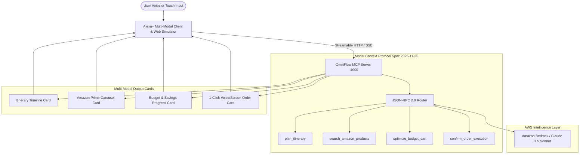

# OmniFlow: Agentic Alexa+ Life & Commerce Copilot

[](https://opensource.org/licenses/MIT)
[](https://modelcontextprotocol.io)
[](https://modelcontextprotocol.io/specification/2025-11-25/basic/transports#streamable-http)
[](https://aws.amazon.com/bedrock/)

> **Submission for "Build, Ship, Shape: Amazon Developer Hackathon"**  
> **Primary Track:** Alexa+ (Agent Skill & Self-Hosted MCP Server)  
> **Mini-Challenge:** AWS Builder (Amazon Bedrock Integration)  
> **Bonus Challenge:** Product Feedback & Friction Log (+10% Bonus)

---

## 🌟 Overview

**OmniFlow** is an autonomous, multi-modal **Alexa+ Agent Skill and self-hosted Model Context Protocol (MCP) Server** compliant with the latest **MCP specification version 2025-11-25** over **Streamable HTTP**.

Rather than simple single-turn voice Q&A, OmniFlow handles high-level life and commerce goals (e.g. *"Plan a 3-day camping trip to Olympic National Park under $300 and buy needed gear"*). It decomposes the goal into autonomous sub-steps, queries specialized tools over MCP, balances the user's budget, surfaces Prime-eligible gear, and delivers an interactive multi-modal screen experience (rich carousels, itinerary tabs, one-touch approval triggers) on Echo Show / Fire TV / Web clients.

---

## 🏗️ Architecture



---

## 🛠️ MCP Tools Implemented

OmniFlow exposes 4 tools via standard MCP JSON-RPC 2.0 and Streamable HTTP:

| Tool Name | Parameters | Description |
| :--- | :--- | :--- |
| `plan_itinerary` | `destination`, `duration_days`, `trip_type`, `budget_limit` | Formulates daily itineraries, outdoor activities, and weather forecasts. |
| `search_amazon_products` | `query`, `category`, `max_price`, `prime_only` | Searches product catalog with live prices, star ratings, and Prime eligibility. |
| `optimize_budget_cart` | `items[]`, `budget_limit` | Reconciles items against budget ceiling, applies bundle discounts and tax. |
| `confirm_order_execution` | `cart_id`, `total_amount`, `delivery_address`, `delivery_speed` | Generates secured token for human-in-the-loop one-touch authorization. |

---

## 🚀 Quickstart & Local Testing

### Prerequisites
- Node.js (v18+)
- npm (v9+)

### Installation
```bash
# Clone the repository
git clone https://github.com/your-username/omniflow-alexa-mcp.git
cd omniflow-alexa-mcp

# Install dependencies
npm install

# Run automated verification tests
npm test

# Start the MCP Server & Alexa+ Web Simulator
npm start
```

### Accessing the Web Simulator
Open **`http://localhost:4000`** in any modern web browser.
- Tap **"Tap to Speak"** or select any sample prompt chip.
- Click **"MCP Protocol Inspector"** at the top right to see live JSON-RPC 2.0 calls over Streamable HTTP in real time.
- Tap **"Confirm Order"** to test human-in-the-loop one-touch purchasing.

---

## 📡 MCP Protocol Endpoints

- **Server Info**: `GET http://localhost:4000/mcp/info`
- **Streamable HTTP Stream**: `GET http://localhost:4000/mcp/stream`
- **JSON-RPC 2.0 Handler**: `POST http://localhost:4000/mcp`

### Example MCP `tools/list` Request:
```bash
curl -X POST http://localhost:4000/mcp \
  -H "Content-Type: application/json" \
  -d '{"jsonrpc": "2.0", "id": 1, "method": "tools/list"}'
```

### Example MCP `tools/call` Request:
```bash
curl -X POST http://localhost:4000/mcp \
  -H "Content-Type: application/json" \
  -d '{
    "jsonrpc": "2.0",
    "id": 2,
    "method": "tools/call",
    "params": {
      "name": "search_amazon_products",
      "arguments": { "query": "camping tent", "prime_only": true }
    }
  }'
```

---

## ☁️ AWS Builder Mini-Challenge Integration

OmniFlow integrates **Amazon Bedrock** (`@aws-sdk/client-bedrock-runtime`) for autonomous reasoning and function dispatch:
- **Model**: `anthropic.claude-3-5-sonnet-20241022-v2:0` (or `amazon.nova-pro-v1:0`).
- **Function Calling**: The Bedrock client receives JSON schemas directly exported from the MCP server's `TOOLS` array.
- **Fail-Safe Offline Mode**: If AWS credentials are not configured in the host environment, OmniFlow automatically activates its built-in deterministic planning engine so judges and evaluators can experience the full multi-step workflow without mandatory AWS keys.

To provide your AWS credentials:
```bash
export AWS_REGION=us-east-1
export AWS_ACCESS_KEY_ID=your_key_id
export AWS_SECRET_ACCESS_KEY=your_secret_key
```

---

## 👥 Hackathon Reviewer Access

In accordance with official hackathon submission rules, this repository has been prepared with an **MIT open-source license**. If maintaining this repo privately, the following Amazon DevRel members should be added as Collaborators:
- `testing@devpost.com`
- `chris-trag`
- `knmeiss`
- `giolaq`
- `anishamalde`
- `mosesroth`
- `emersonsklar`

---

## 📄 License
This project is licensed under the [MIT License](LICENSE).
